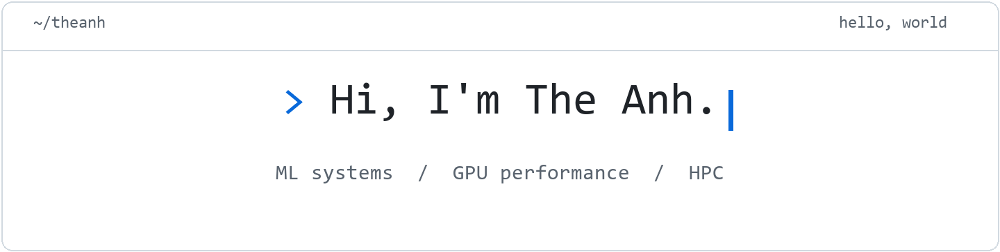

  <picture><source media="(prefers-color-scheme: dark)" srcset="assets/hello-the-anh.gif" /><source media="(prefers-color-scheme: light)" srcset="assets/hello-the-anh-light.gif" /></picture>

  I build agent loops that automatically optimize inference for Cosmos world models. 
  Previously at Moreh, I focused on high-performance LLM inference with vLLM on AMD GPUs.

---

<table width="100%" align="center">
  <tr>
    <td width="9999" valign="top">
      <h3><picture><source media="(prefers-color-scheme: dark)" srcset="assets/icons/work.svg" /><source media="(prefers-color-scheme: light)" srcset="assets/icons/work-light.svg" /></picture> Current work</h3>
      
<strong>NVIDIA</strong> &middot; <code>current</code> 
      Building agent loops to optimize Cosmos world model inference on NVIDIA GPUs.

      
<strong>Moreh</strong> &middot; <code>previously</code> 
      Optimizing LLM serving with vLLM on AMD GPUs.

    </td>
    <td width="9999" valign="top">
      <h3><picture><source media="(prefers-color-scheme: dark)" srcset="assets/icons/research.svg" /><source media="(prefers-color-scheme: light)" srcset="assets/icons/research-light.svg" /></picture> Current research</h3>
      
<strong><a href="https://github.com/theanh-ktmt/PGA-KD">PGA-KD</a></strong> &middot; <code>EMNLP 2026</code>

      
<a href="https://aclanthology.org/2026.emnlp-main.257/">Read the paper &#8599;</a>

    </td>
  </tr>
</table>

### <picture><source media="(prefers-color-scheme: dark)" srcset="assets/icons/stack.svg" /><source media="(prefers-color-scheme: light)" srcset="assets/icons/stack-light.svg" /></picture> Toolbox

  <picture><source media="(prefers-color-scheme: dark)" srcset="assets/badges/agents.svg" /><source media="(prefers-color-scheme: light)" srcset="assets/badges/agents-light.svg" /></picture>
  <picture><source media="(prefers-color-scheme: dark)" srcset="assets/badges/gpu.svg" /><source media="(prefers-color-scheme: light)" srcset="assets/badges/gpu-light.svg" /></picture>
  <picture><source media="(prefers-color-scheme: dark)" srcset="assets/badges/distributed.svg" /><source media="(prefers-color-scheme: light)" srcset="assets/badges/distributed-light.svg" /></picture>
  <picture><source media="(prefers-color-scheme: dark)" srcset="assets/badges/vllm.svg" /><source media="(prefers-color-scheme: light)" srcset="assets/badges/vllm-light.svg" /></picture>
  <picture><source media="(prefers-color-scheme: dark)" srcset="assets/badges/sglang.svg" /><source media="(prefers-color-scheme: light)" srcset="assets/badges/sglang-light.svg" /></picture>
  <picture><source media="(prefers-color-scheme: dark)" srcset="assets/badges/pytorch.svg" /><source media="(prefers-color-scheme: light)" srcset="assets/badges/pytorch-light.svg" /></picture>
  <picture><source media="(prefers-color-scheme: dark)" srcset="assets/badges/triton.svg" /><source media="(prefers-color-scheme: light)" srcset="assets/badges/triton-light.svg" /></picture>

<strong>Education</strong> · B.Eng. Computer Engineering, Hanoi University of Science and Technology.

---

  <a href="https://theanh-ktmt.github.io/"><picture><source media="(prefers-color-scheme: dark)" srcset="assets/badges/website.svg" /><source media="(prefers-color-scheme: light)" srcset="assets/badges/website-light.svg" /></picture></a>
  <a href="https://www.linkedin.com/in/theanh-ktmt/"><picture><source media="(prefers-color-scheme: dark)" srcset="assets/badges/linkedin.svg" /><source media="(prefers-color-scheme: light)" srcset="assets/badges/linkedin-light.svg" /></picture></a>
  <a href="mailto:trantheanh.ktmt@gmail.com"><picture><source media="(prefers-color-scheme: dark)" srcset="assets/badges/email.svg" /><source media="(prefers-color-scheme: light)" srcset="assets/badges/email-light.svg" /></picture></a>

