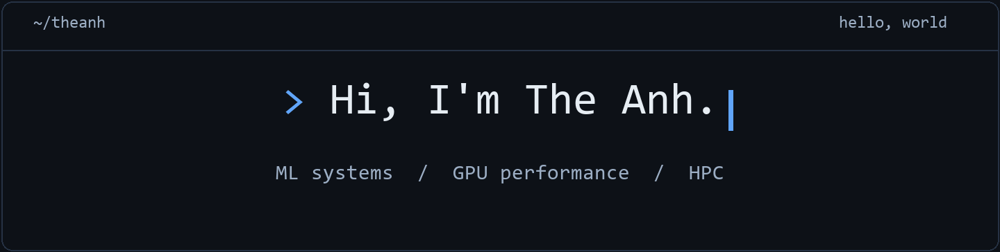

  

  I build agent loops that automatically optimize inference for Cosmos world models. 
  Previously at Moreh, I focused on high-performance LLM inference with vLLM on AMD GPUs.

---

<table width="100%" align="center">
  <tr>
    <td width="9999" valign="top">
      <h3> Current work</h3>
      
<strong>NVIDIA</strong> &middot; <code>current</code> 
      Building agent loops to optimize Cosmos world model inference on NVIDIA GPUs.

      
<strong>Moreh</strong> &middot; <code>previously</code> 
      Optimizing LLM serving with vLLM on AMD GPUs.

    </td>
    <td width="9999" valign="top">
      <h3> Current research</h3>
      
<strong><a href="https://github.com/theanh-ktmt/PGA-KD">PGA-KD</a></strong> &middot; <code>EMNLP 2026</code>

      
<a href="https://aclanthology.org/2026.emnlp-main.257/">Read the paper &#8599;</a>

    </td>
  </tr>
</table>

###  Toolbox

  
  
  
  
  
  
  

<strong>Education</strong> · B.Eng. Computer Engineering, Hanoi University of Science and Technology.

---

  
  
  

